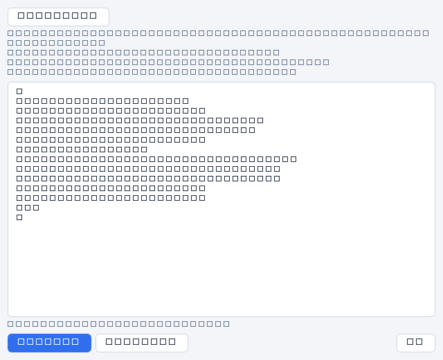

# 预检参数配置

预检参数依赖随 ucm-toolkit 安装的 JSON 配置文件。步骤4 的「⚙ 预检参数配置...」提供容器内的查看/编辑入口。



## 配置文件在哪

| 文件 | 位置 | 说明 |
|---|---|---|
| 出厂默认 | `<site-packages>/ucm_toolkit/tools/precheck/precheck.defaults.json` | 随 ucm-toolkit whl 安装，工具按包位置自动定位 |
| 自定义 | 容器内 `/root/ucm-deploy/precheck.json` | 本工具保存，预检以 `--config` 引用 |

**优先级**：代码常量（JSON 缺失时后备）→ 安装的 defaults.json → `--config` 用户文件 → CLI 参数。

!!! important "叠加语义"
    自定义配置**叠加于出厂默认之上，只需写要覆盖的键**。例如只改带宽阈值：

    ```json
    {
      "bandwidth": {
        "threshold_gb": 4.0
      }
    }
    ```

## 出厂默认值参考

```json
{
  "mount_path": null,
  "kernel_min": "5.10",
  "cuda_min_compute_cap": 8.0,
  "ascend_min_hdk": "25.2.0",
  "shm_min_gib": 512.0,
  "bandwidth": {
    "shard_sizes": ["180k", "8m"],
    "worker_counts": [1, 8, 16],
    "engines": ["psync", "aio"],
    "modes": ["dump", "read", "mix"],
    "block_number": 32,
    "shard_number": 1,
    "dump_epochs": 8,
    "load_epochs": 8,
    "mixed_epochs": 8,
    "rw_ratio": 4,
    "barrier_timeout": 60,
    "combo_timeout": 120,
    "aio_queue_depth": 4096,
    "threshold_gb": 8.0
  }
}
```

即带宽测试默认为 **2 档分片（180 KiB / 8 MiB）× 3 档并发（1/8/16）× 2 引擎（psync/aio）= 12 个组合**，每组合跑 dump/load/mixed 三阶段（读写比 1:4、每阶段 8 轮、单组合超时 120s）。

## 操作流程

1. 点步骤4 的「⚙ 预检参数配置...」打开对话框——自动从容器读取当前配置（**优先已保存的自定义配置**，否则定位并读取出厂默认）；
2. 编辑 JSON，**实时语法校验**（语法错误时「保存并启用」禁用）；
3. 「💾 保存并启用」写入容器内 `/root/ucm-deploy/precheck.json`，此后每次预检自动带 `--config`；
4. 「↩ 恢复默认配置」删除自定义文件，回到出厂默认。

页面「预检参数：」状态实时显示当前模式（进入页面自动探测，容器重建后自动复位为出厂默认）。
