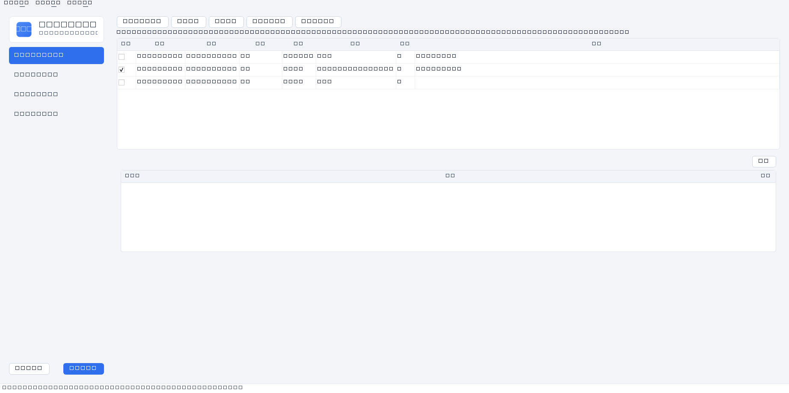
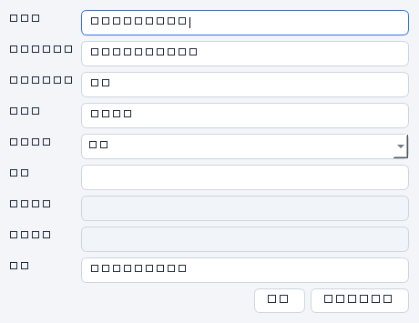

# 步骤1 · 服务器管理

登录要部署的服务器，探测设备信息。**一次只登录一台**（换勾自动切换），后续所有步骤都作用于勾选的服务器。

## 操作流程

### 1. 添加服务器

点「➕ 添加服务器」，填写登录信息：

- 支持**密码**或**私钥**两种认证方式；
- 登录信息保存在 `~/.ucm_deployer/servers.json`（密码 **Fernet 加密**），下次打开程序直接复用——**打开程序即显示历史服务器列表**；
- 新增后自动勾选登录，无需再手动勾选。

### 2. 测试连接

点「🔌 测试连接」验证 SSH 可达（结果见底部任务面板日志）。

### 3. 探测设备

点「🔍 探测设备」自动识别：

- 设备类型与型号（`npu-smi info` / `nvidia-smi`，如 `Ascend 910B3`）
- **卡数**（步骤2/3 的设备映射依据）
- **CPU 架构**（`uname -m`，步骤2 匹配校验依据）

探测结果持久保存；步骤2 的构建平台、步骤3 的设备映射都会按该设备类型自动适配。

### 4. 勾选登录

勾选「登录」列选择本次操作的服务器。

!!! tip "操作对象统一"
    编辑 / 删除 / 测试连接 / 探测设备均**作用于勾选的服务器**；未勾选时弹提示引导。列表支持关键字筛选与悬浮查看完整名称。

## 常见问题

- **连接失败**：检查 IP/端口/密码；`密码` 与 `私钥` 认证方式需与服务器配置一致。
- **探测不到设备**：确认宿主机已装 `npu-smi`（Ascend）或 `nvidia-smi`（NVIDIA）且在 PATH 中。
