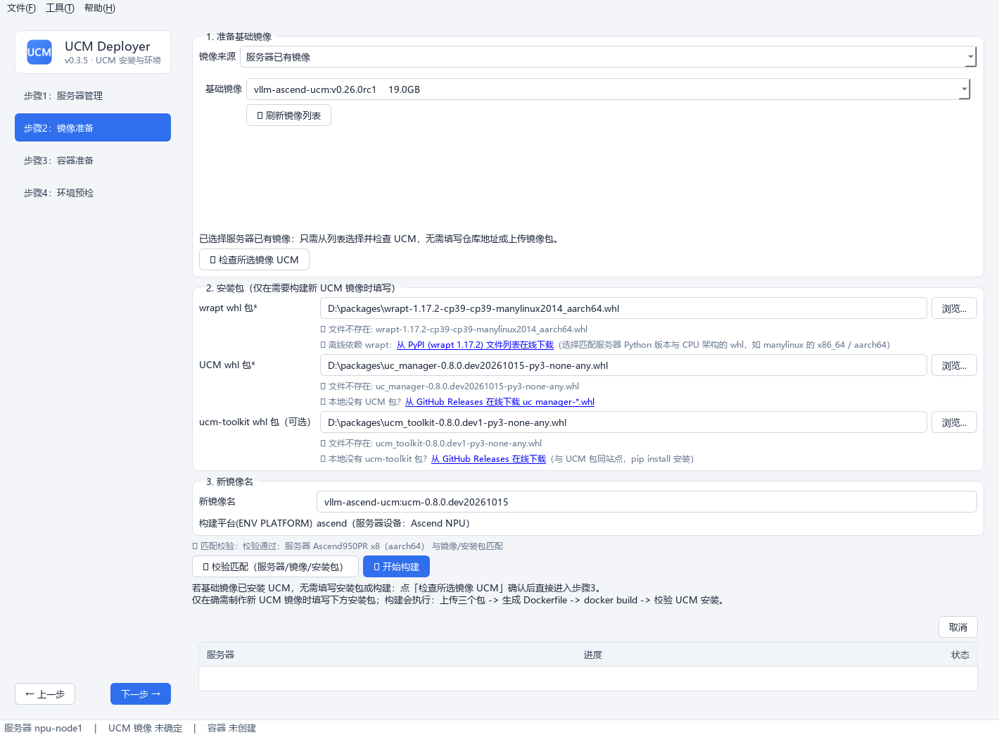
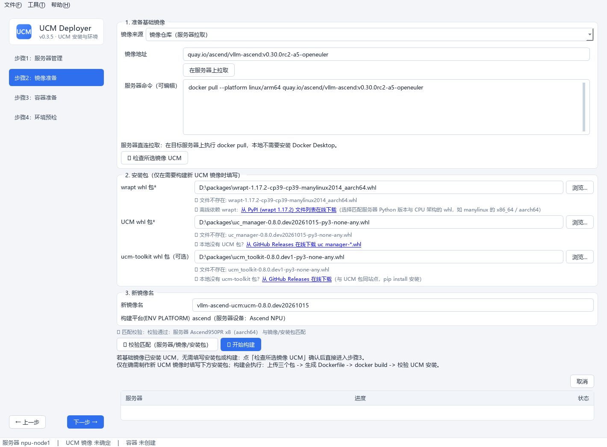

# 步骤2 · 镜像构建

在已登录服务器上，把 wrapt / UCM /（可选）ucm-toolkit 三个包安装进基础镜像，构建带 UCM 的引擎镜像。

## 操作流程

### 1. 选择镜像来源

「镜像来源」一次只显示一种操作方式，避免同时出现多个输入框和按钮：

| 来源 | 适用场景 | 操作 |
|---|---|---|
| 服务器已有镜像（默认） | 设备上已有可用基础镜像 | 直接从列表选择，**无需填写仓库地址** |
| 本地镜像包（离线导入） | 服务器无法访问镜像仓库 | 选择本地 tar/tar.gz，点「导入到服务器」 |
| 镜像仓库（服务器拉取） | 服务器可访问仓库 | 输入镜像引用，点「在服务器上拉取」 |

镜像列表来自服务器 `docker images`（进入本页自动加载，也可点「🔄 刷新镜像列表」）：

- 下拉框**输入关键字即可筛选**（包含匹配、不区分大小写），只能选中列表中的镜像；
- 显示镜像大小，悬浮显示创建时间，疑似 UCM 镜像排在最前；
- 服务器直连拉取时，工具在目标服务器执行 `docker pull --platform linux/arm64` 或 `linux/amd64`，不占用本地磁盘、不生成 tar.gz、本地无需 Docker Desktop；
- 拉取命令会先显示在「服务器命令（可编辑）」中，可检查或修改后执行；命令必须以 `docker pull` 开头；
- tar 导入或服务器拉取成功后，自动切回「服务器已有镜像」并选中刚得到的镜像。

### 2. 选择安装包

三个包输入框下方附**在线下载链接**（本地没有包时点击直达浏览器）：

| 包 | 必填 | 来源 |
|---|---|---|
| wrapt whl | ✅ | [PyPI wrapt 1.17.2](https://pypi.org/project/wrapt/1.17.2/#files)（注意匹配架构） |
| UCM whl | ✅ | [GitHub Releases](https://github.com/ModelEngine-Group/unified-cache-management/releases) |
| ucm-toolkit whl | 可选 | 与 UCM 同站点（步骤4 预检需要） |

选择文件后**即时显示**文件有效性与架构标记（`x86_64` / `aarch64` / 纯 Python 包），帮助在上传前确认匹配。

### 3. 新镜像名

默认自动生成 **`<基础镜像名>:ucm-<UCM版本号>`**（版本号取自 UCM whl 文件名，如 `vllm-ascend:ucm-0.8.0.dev20261015`）；手动修改后不再自动覆盖。

### 4. 匹配校验

点「🔍 校验匹配」手动触发；点「🔨 开始构建」时也会**自动强制校验**：

- 服务器设备类型（NPU/GPU）vs 镜像平台（按镜像名推断 ascend/nvidia）；
- whl 文件名架构标记 vs 服务器 `uname -m`。

不匹配则**拒绝构建**并说明原因。

### 5. 开始构建

上传三个包 → 自动生成 Dockerfile（`ENV PLATFORM`；**先离线安装 wrapt，再离线安装 UCM 与 ucm-toolkit whl**）→ `docker build` → 校验新镜像内 UCM 已安装。过程与 `docker build` 输出实时进入底部日志页签。

!!! tip "跳过构建"
    若所选基础镜像已安装 UCM，点「✅ 检查所选镜像 UCM」确认后可直接进入步骤3。
