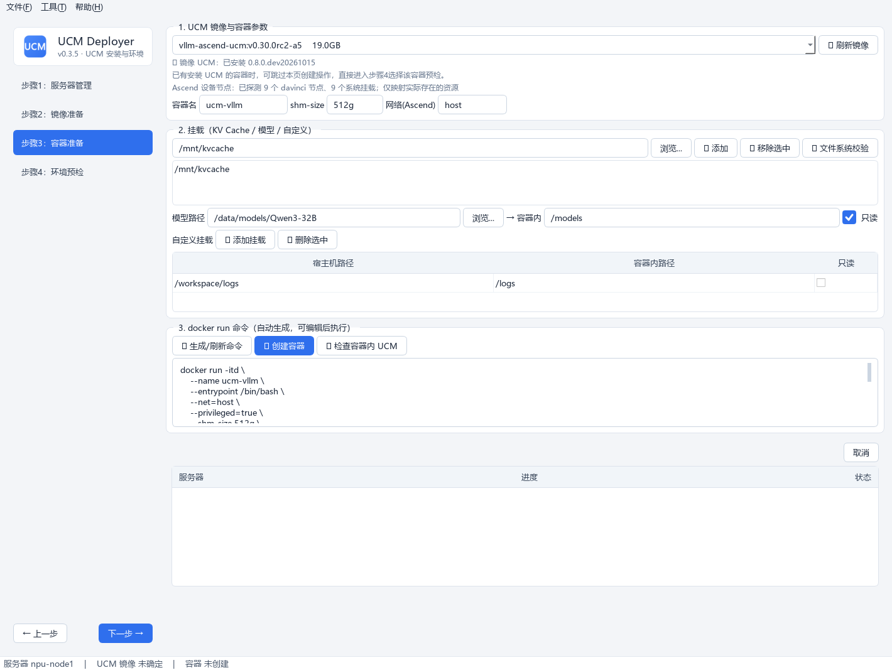
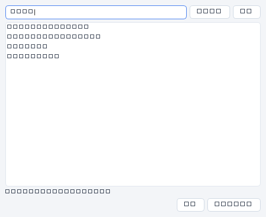

# 步骤3 · 容器创建

基于 UCM 镜像创建 UCM 容器：自动探测并映射实际存在的加速卡设备节点与系统资源，配置挂载，生成的 docker run 命令**可编辑后执行**。

工具固定生成 `--entrypoint /bin/bash`，且不在镜像后追加 `bash`。容器只创建并保持在 Bash 交互环境中，**不会启动 vLLM 或其他推理服务**。



## 操作流程

### 1. 选择 UCM 镜像

进入本页自动加载镜像列表；**选择镜像时自动后台校验镜像内 UCM 安装情况**：

- ✓ 已安装：显示版本，自动记录为本服务器使用的镜像；
- ✗ 未安装：提示回步骤2 构建或换镜像（创建容器前会再次拦截确认）。

### 2. 容器参数

| 参数 | 默认 | 说明 |
|---|---|---|
| 容器名 | `ucm-vllm` | — |
| shm-size | `512g` | UCM KV-cache 页缓存要求 ≥512 GiB |
| 网络 | `host` | Ascend 容器使用；NVIDIA 容器固定用 `-p 8000:8000` 端口映射 |

### 3. 挂载配置

- **KV Cache 目录**：可添加多个（「浏览」弹出**容器内/宿主机目录浏览器**）；挂载到容器内相同路径；「🔍 文件系统校验」检查目录所在文件系统（本地/网络存储）；
- **模型路径**：宿主机路径 → 容器内路径（默认 `/models`），默认只读；
- **自定义挂载**：任意宿主机/容器路径映射，可勾选只读。



### 4. 生成 / 执行命令

点「🔁 生成/刷新命令」自动生成 docker run。对 Ascend 服务器，工具会先探测宿主机实际存在的设备节点与驱动/工具/配置挂载，只生成存在的 `--device` 与 `-v` 参数：

- 兼容 `Ascend950PR` / A5：没有 `/dev/devmm_svm` 时不会生成该参数；
- 探测到 `/dev/ummu` 或 `/dev/uburma` 时自动添加 `--privileged=true`；
- 自动包含实际存在的 `/usr/local/Ascend/driver`、`/etc/ascend_install.info`、`/etc/hccl_rootinfo.json`、`/etc/hixlep`、`/usr/local/dcmi`、`/usr/local/sbin`、`/usr/local/bin/npu-smi`、`/usr/lib64`、`/root/.cache` 等挂载。

=== "NPU（vllm-ascend）"

    ```bash
    docker run -itd \
        --name ucm-vllm \
        --entrypoint /bin/bash \
        --net=host --shm-size 512g \
        --device /dev/davinci0 ... --device /dev/davinci7 \
        --device /dev/davinci_manager --device /dev/hisi_hdc \
        --device /dev/ummu --device /dev/uburma \
        --privileged=true \
        -v /usr/local/Ascend/driver:/usr/local/Ascend/driver \
        -v /etc/ascend_install.info:/etc/ascend_install.info \
        -v /etc/hccl_rootinfo.json:/etc/hccl_rootinfo.json \
        -v /etc/hixlep:/etc/hixlep \
        -v /usr/local/dcmi:/usr/local/dcmi \
        -v /usr/local/sbin:/usr/local/sbin \
        -v /usr/local/bin/npu-smi:/usr/local/bin/npu-smi \
        -v /usr/lib64:/usr/lib64 \
        -v /root/.cache:/root/.cache \
        -v /mnt/kvcache:/mnt/kvcache \
        -v /data/models/Qwen3-32B:/models:ro \
        vllm-ascend-ucm:v0.26.0rc1
    ```

=== "GPU（vllm）"

    ```bash
    docker run -itd \
        --name ucm-vllm \
        --entrypoint /bin/bash \
        --runtime nvidia --gpus all \
        -p 8000:8000 --ipc=host --shm-size 512g \
        -v /mnt/kvcache:/mnt/kvcache \
        -v /data/models:/models:ro \
        vllm-openai-ucm:latest
    ```

命令**可编辑**，点「🚀 创建容器」按编辑框内容执行；执行前会校验命令仍包含 `--entrypoint /bin/bash` 且未在镜像后追加 `bash`。完成后可点「✅ 检查容器内 UCM」确认。

!!! note "下一步"
    容器创建成功后，进入[步骤4 · 环境预检](step4.md)在容器内做部署前检查。
