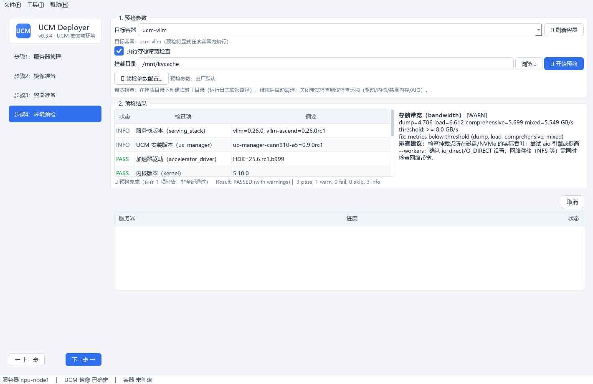

# 步骤4 · 环境预检

在**已创建的容器内**运行 `ucm-toolkit run precheck`，提前发现可能影响启动或缓存读写的问题。

如果 toolkit 输出 `uc_manager -` 或 `HDK=?`，Deployer 不会直接放弃识别，而会在容器内独立探测事实来源：pip 包元数据（兼容 `uc-manager-cann910-a5` 等平台变体）、`/usr/local/Ascend/driver/version.info`、`npu-smi info`、`nvidia-smi`。补齐后的结果会在详情中标注 `[deployer] fact source`，不隐藏 toolkit 原始输出。

## 操作流程

### 1. 确认目标容器

自动回显步骤3 创建的容器（未创建时提示引导返回步骤3）。

### 2. 选择检查模式

「执行存储带宽检查」复选框（**默认开启**）：

- **开启**：填写**容器内**挂载目录（须为步骤3 已映射进容器的目录）——预检会在该目录下创建临时子目录（`ucm-precheck-*`）执行读写负载，**运行日志会播报该临时目录的完整路径**（含清理结果），便于在环境上核对；结束后自动清理；
- **关闭**：仅环境检查（`--skip-bandwidth`：驱动/内核/共享内存/AIO），无需填挂载目录。

!!! warning "挂载目录校验"
    「浏览」列出的是**容器内可见目录**；自填路径会在预检前校验容器内存在性——**容器内不存在的目录直接拦截报错**，不会凭空创建（避免带宽测到容器写层导致结果失真）。

### 3. 开始预检

点「🔍 开始预检」，命令输出实时进入底部日志页签。

### 4. 查看结果

| 区域 | 内容 |
|---|---|
| 左侧表格 | 状态（**PASS 绿 / WARN 橙 / FAIL 红 / INFO·SKIP 灰**）· 检查项中文名 · 摘要 |
| 右侧详情区 | 点击结果行显示**完整详情**：原始输出、阈值、**中文排查建议** |
| 顶部汇总 | 三态判定：`✓ 预检通过（无警告）` / `⚠ 预检完成（存在 N 项警告，非全部通过）` / `✗ 预检未通过` |

### 检查项一览

| 检查项 | 默认阈值/行为 |
|---|---|
| 服务栈版本 / UCM 版本 / AIO 资源 | INFO，仅展示；UCM 版本支持 pip 多格式与平台变体识别 |
| 加速器驱动 | 缺失失败；Ascend HDK > 25.2.0，较低警告；支持 `version.info` / `npu-smi` / `nvidia-smi` 补齐 |
| 内核 | ≥ 5.10 |
| 共享内存 /dev/shm | < 512 GiB 警告 |
| 存储带宽 | 最佳组合聚合带宽 < 8 GB/s 警告 |

!!! tip "容器内 npu-smi 报 rc=172 / -8020？"
    `dcmi model initialized failed, because the device is used (ret -8020)` 通常表示 **NPU 正被其他进程/容器占用**（宿主机 `npu-smi info` 可正常查看）——该 WARN 不影响推理与带宽检查，停用占用方后重试即可恢复。

预检参数（带宽矩阵、阈值等）支持自定义，见 [预检参数配置](precheck-config.md)。
