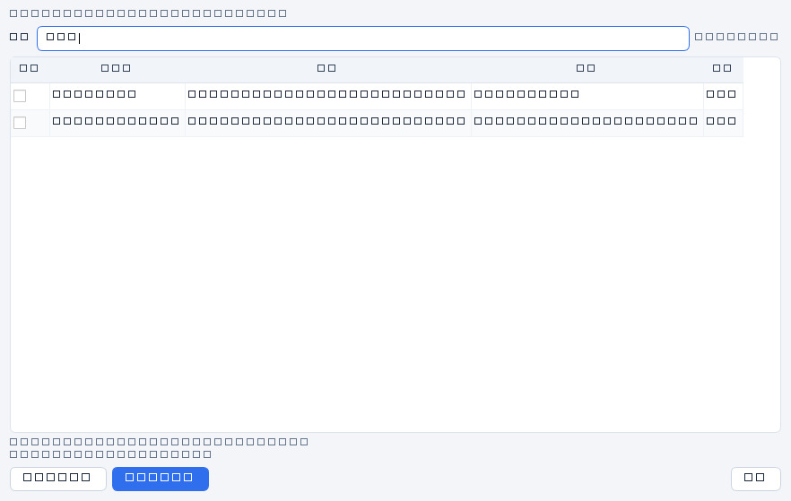
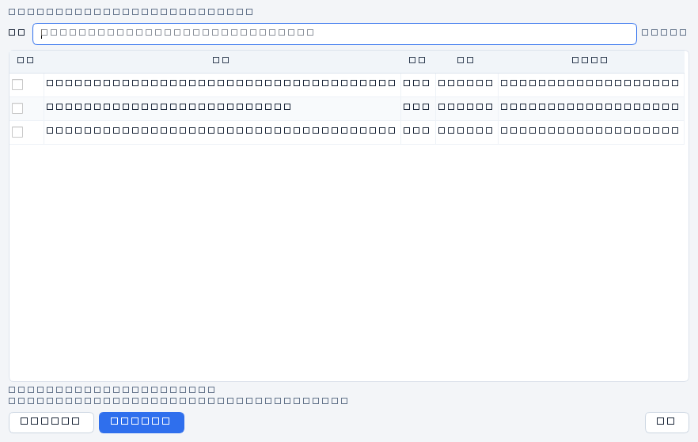

# 工具菜单 · 清理容器/镜像

三步流程之外的运维善后工具（主菜单「工具」），作用于**当前勾选登录的服务器**。

## 清理容器

菜单「工具 → 清理容器...」：

- 自动加载服务器上全部容器（**含已停止**，`docker ps -a`）；
- 勾选后点「🗑 删除选中」，确认后执行 `docker rm -f`——**运行中的容器将被强制停止并删除**；
- 完成后列表自动刷新。

## 清理镜像

菜单「工具 → 清理镜像...」：

- 自动加载服务器上全部镜像；
- 勾选后点「🗑 删除选中」，确认后执行 `docker rmi -f`——**被运行中容器引用的镜像会被强制删除**。

## 通用功能

| 功能 | 说明 |
|---|---|
| **关键字筛选** | 整行匹配（名称/镜像/ID/状态等，不区分大小写）；筛选**不丢失已勾选**；实时显示「当前 N/M 条」 |
| **长名称完整可见** | 列宽按内容自适应、超宽可横向滚动；悬浮显示**完整名称** |
| **删除确认** | 确认框列出全部将删除的对象名 |
| 刷新列表 | 重新从服务器拉取 |
