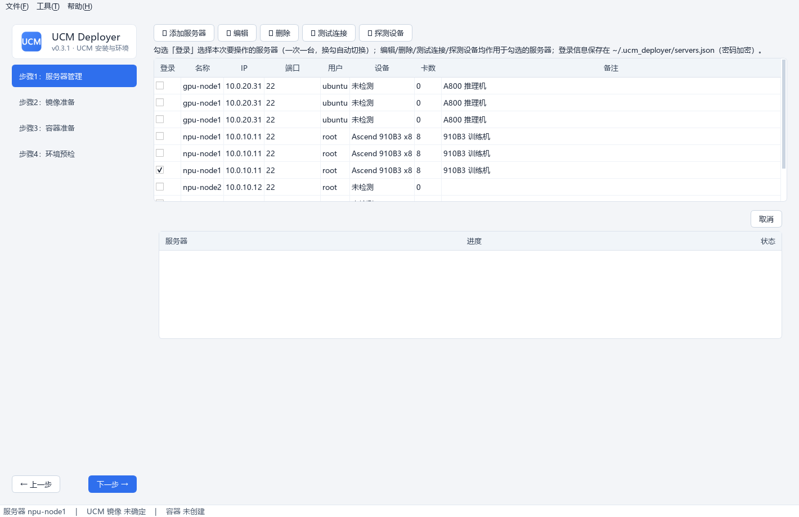

# UCM Deployer

**UCM (Unified Cache Management) 安装与环境预检工具 —— Windows 桌面版**

面向 vLLM / vLLM-Ascend / SGLang 运行环境（Ascend NPU / NVIDIA GPU），把 UCM 的安装与环境预检简化为五个向导步骤：

```
① 服务器管理 → ② 镜像准备 → ③ 容器创建 → ④ 环境预检 → ⑤ 批量部署
```

[快速开始 :material-rocket-launch:](guide/install.md){ .md-button .md-button--primary }
[下载最新版 exe](https://github.com/ucm-system/UCM-Deployer/releases/latest/download/UCM-Deployer.exe){ .md-button }

---

## 功能总览



| 步骤 | 功能亮点 |
|---|---|
| **① 服务器管理** | SSH 登录信息本地加密保存/复用；单选登录；`npu-smi`/`nvidia-smi` 设备探测（型号/卡数/CPU 架构） |
| **② 镜像准备** | 单一来源选择器：复用服务器已有镜像、离线导入 tar 包，或让目标服务器直连 `docker pull`；自动探测基础镜像运行时并校验 wrapt/UCM/ucm-toolkit whl |
| **③ 容器创建** | 选 UCM 镜像（**选择时自动校验**）；自动探测并映射实际存在的 Ascend 设备节点、驱动与工具挂载，兼容 Ascend950PR/A5；固定 `--entrypoint /bin/bash` 只创建容器、不启动推理服务；docker run 命令**可编辑**后执行 |
| **④ 环境预检** | 容器内运行 `ucm-toolkit run precheck`（环境检查 + **可选带宽测试**）；UCM 与驱动版本支持多来源补齐；**预检参数可配置**；结果表格+详情区展示（中文名与排查建议） |
| **⑤ 批量部署** | 一台服务器制作镜像后向**多台服务器**批量执行「镜像分发 → 容器创建 → 预检」；tar 中转 / 仓库拉取两种分发方式；每台独立进度与日志；**部署数据模板（JSON）导出/导入**复用登录信息与容器/预检配置 |
| **工具菜单** | 清理指定容器/镜像（关键字筛选、悬浮看全名） |

## 核心特性

- **单服务器流程**：一次登录一台服务器，全部操作作用于勾选的服务器
- **多服务器批量部署**：勾选多台目标并行执行镜像分发、容器创建与环境预检，逐台展示进展
- **先展示、可编辑、再执行**：所有生成的命令完整展示给用户，可修改后再执行
- **自由跳转**：步骤间可任意跳转，前置条件在操作执行时拦截提示
- **凭据安全**：密码 Fernet 加密保存在本地（`~/.ucm_deployer/`）

## 环境要求

- 本地：Windows + 双击 `UCM-Deployer.exe` 即可（无需 Python，也无需 Docker Desktop）
- 目标服务器：Linux + SSH + Docker；Ascend 需 `npu-smi`，NVIDIA 需 `nvidia-smi`

## 相关链接

- [GitHub 仓库](https://github.com/ucm-system/UCM-Deployer)
- [下载发布版](https://github.com/ucm-system/UCM-Deployer/releases)
- [UCM 项目（unified-cache-management）](https://github.com/ModelEngine-Group/unified-cache-management)
